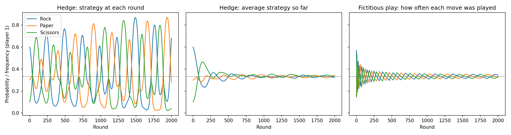

# RPS
Game theory (Rock ,Paper ,Scissors), so in this game we have 2 computers acting like 2 players who are trying to beat eachother by learning about eachother previous moves . I wrote this to learn the basics of learning in games, with multi-agent learning as the goal

## how ? 
the 2 players start with an uneven startegy (let's say 60% rock , 30% paper and 10% scissors this usally simulating the human's prepective while playing this game ) , then keep updating that strategy round after round . 

Two learning methods are compared: 

 - **Hedge (multiplicative weights):** each round, a move's probability is multiplied by `exp(eta * score)`, where `score` is how well that move does against the opponent's current strategy. The probabilities are then normalised to sum to 1.

 - **Fictitious play:** each player counts the opponent's past moves and plays the best reply to those counts.

 note : The balanced solution (Nash equilibrium) of rock paper scissors is 1/3 for each move.

 ## Results : 

 

- With Hedge, the players' strategies keep cycling and never settle at 1/3 and the **average** Hedge strategy over time does converge to about 1/3 each.
- With fictitious play, the frequencies of each move converge to about 1/3 each.

So in this game the play itself cycles, but the long-run average reaches the balance.

## Simplification

So hedge here uses expected scores computed from the opponent's exact probabilities. Players do not sample random moves and learn from actual wins and losses. 
This keeps the curves smooth. A sampled version would be a natural next step.

## running config 

to run this code install these libraries 

```
pip install numpy matplotlib

then run the code 

python g.py

```
note : The plot is saved as `rps_learning.png`.

## future work 
- Sampled version where players only see the outcome of each round
- Regret matching